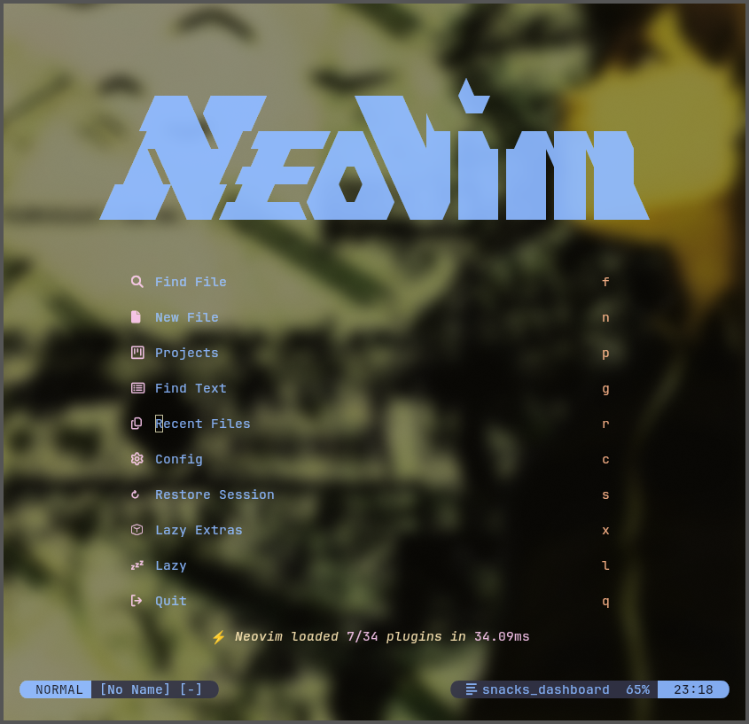
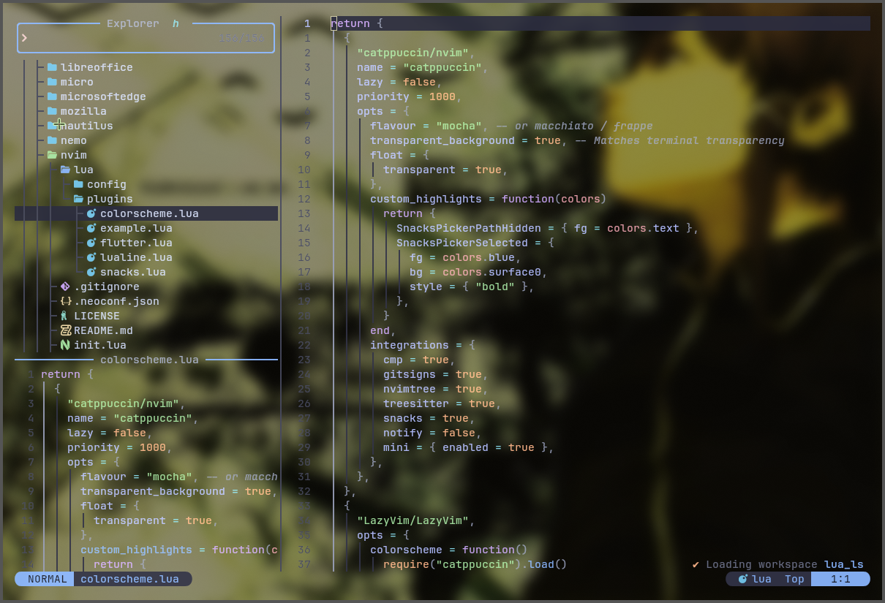

<div align="center">
  <h1>My Neovim Configuration</h1>
</div>

---

## Screenshots

<div align="center">
  <br>
  
  <p><em>Main Editor View</em></p>
  <br>
  
  <p><em>File Explorer View</em></p>
  <br>
</div>

---
## Installation


1. **Backup your existing configuration:**
   ```bash
   mv ~/.config/nvim ~/.config/nvim.bak
   mv ~/.local/share/nvim ~/.local/share/nvim.bak
   mv ~/.local/state/nvim ~/.local/state/nvim.bak
   mv ~/.cache/nvim ~/.cache/nvim.bak
   ```

## 📂 Repository Structure

- 📁 `nvim/` - The actual Neovim configuration files.

